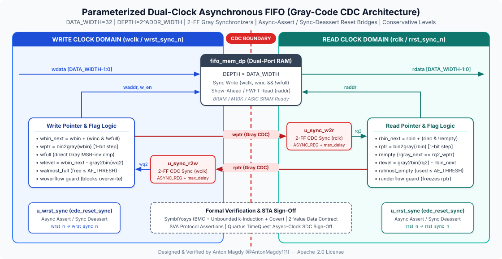

# Parameterized Dual-Clock Asynchronous FIFO (`async-fifo-cdc`)

**Designed & Verified by [Anton Magdy (`@AntonMagdy111`)](https://github.com/AntonMagdy111)**

[](https://github.com/AntonMagdy111/async-fifo-cdc/actions/workflows/ci.yml)
[](LICENSE)

-brightgreen)


A tapeout-style, parameterized **Dual-Clock Asynchronous FIFO** in synthesizable SystemVerilog engineered for rigorous Clock Domain Crossing (CDC) closure. Built on Clifford Cummings' Gray-code pointer architecture and upgraded with **asynchronous-assert / synchronous-deassert reset synchronizers**, **conservative write/read occupancy levels**, **configurable almost-full / almost-empty thresholds**, **overflow/underflow protection**, **unbounded formal verification (`SymbiYosys` k-induction)**, **bindable SVA assertions**, and **4-corner Quartus TimeQuest STA + MTBF sign-off**.



---

## Microarchitectural Features

| Feature | Implementation Detail |
|---|---|
| **Parameterization** | `DATA_WIDTH` (default `32`), `ADDR_WIDTH` (`DEPTH = 2^ADDR_WIDTH`, default `4` → 16 entries), `SYNC_STAGES` (≥2, default `2`), `ALMOST_FULL_THRESH`, `ALMOST_EMPTY_THRESH`, `USE_RESET_SYNC`. |
| **Gray-Code CDC Crossing** | `(ADDR_WIDTH+1)`-bit Gray-coded pointers (`wptr`, `rptr`) guarantee Hamming distance ≤ 1 on every transition, preventing multi-bit metastability corruption across unrelated clock domains. |
| **Metastability-Hardened Synchronizers** | [rtl/cdc_sync_2ff.sv](rtl/cdc_sync_2ff.sv) embeds explicit vendor attributes (`ASYNC_REG`, `SHREG_EXTRACT="NO"`, Intel `SYNCHRONIZER_IDENTIFICATION FORCED_IF_ASYNCHRONOUS`) to prevent shift-register packing and maximize MTBF. |
| **Reset Domain Crossing (RDC)** | [rtl/cdc_reset_sync.sv](rtl/cdc_reset_sync.sv) implements async-assert / sync-deassert 2-FF reset bridges independently for `wclk` and `rclk`, eliminating reset recovery/removal violations. |
| **Timing-Optimized Flag Paths** | `wfull` and `rempty` use direct registered Gray-code comparators (off the `gray2bin` XOR tree); `wlevel` (conservative upper bound ≥ true fill) and `rlevel` (conservative lower bound ≤ true fill) drive registered `walmost_full` and `ralmost_empty`. |
| **Overflow / Underflow Safety** | Attempts to push on `wfull` or pop on `rempty` are gated cleanly (`w_en = winc && !wfull`, `r_en = rinc && !rempty`) while asserting diagnostic `woverflow` / `runderflow` flags—memory and pointers are never corrupted. |

---

## Repository Structure

```text
async-fifo-cdc/
├── rtl/
│   ├── async_fifo.sv         # Top-level dual-clock async FIFO (+ embedded SymbiYosys formal properties)
│   ├── cdc_sync_2ff.sv       # Parameterized multi-stage CDC synchronizer w/ vendor ASYNC_REG attributes
│   ├── cdc_reset_sync.sv     # Async-assert, sync-deassert reset bridge
│   └── fifo_mem_dp.sv        # Parameterized True Dual-Port RAM (M10K/BRAM & ASIC SRAM friendly)
├── formal/
│   ├── async_fifo.sby        # SymbiYosys formal suite (bmc, prove k-induction, cover)
│   └── async_fifo_sva.sv     # Bindable SystemVerilog Assertions (ModelSim / Questa / VCS / JasperGold)
├── tb/
│   └── tb_async_fifo.sv      # 6-scenario dual-clock stress TB (>21,000 TX scoreboard + coverage)
├── constraints/
│   └── async_fifo.sdc        # Dual-clock SDC: async groups + skew-bounded Gray-bus set_max_delay
├── synth/
│   ├── run_quartus_sta.tcl   # Automated Intel Quartus Prime Synthesis + Fitter + TimeQuest STA script
│   └── reports/              # Captured Quartus Prime 24.1 fit, STA, and MTBF sign-off reports
├── sim/
│   └── run_modelsim.do       # Automated ModelSim/Questa regression script with SVA binding
└── docs/
    └── async_fifo_arch.svg   # Architecture schematic
```

---

## Verification & Formal Sign-Off Results

### 1. Multi-Simulator Functional Verification & SVA

All 6 clock-ratio, threshold, overflow/underflow, and mid-flight asynchronous reset scenarios were executed across **3 independent simulators** with **0 errors and 0 SVA assertion failures**:

| Verification Tool / Suite | Scope | Result |
|---|---|---|
| **Verilator 5.024 Lint** (`-Wall -Werror-LATCH -Werror-WIDTH -Werror-UNOPTFLAT`) | Full RTL (`async_fifo` + submodules) | **PASS — 0 errors, 0 warnings** |
| **ModelSim Intel FPGA 2020.1 + Bindable SVA** (`formal/async_fifo_sva.sv`) | 6 scenarios, **21,000 / 21,000** bit-exact TX | **PASS — 0 errors, 0 SVA failures** |
| **Verilator 5.024 (`--binary --timing`)** | 6 scenarios, **21,000 / 21,000** bit-exact TX | **PASS — 0 errors** |
| **Icarus Verilog 12.0 (`-g2012`)** | 6 scenarios, **21,000 / 21,000** bit-exact TX | **PASS — 0 errors** |
| **SymbiYosys Formal (`bmc` + `prove` k-Induction + `cover`)** | Multiclock unbounded proof (`smtbmc bitwuzla`, CI) | **PASS — `prove` (2 s), `cover` (3 s), `bmc` depth-25 (10 s)** |

#### Test Scenarios & Measured Coverage Bins (`tb/tb_async_fifo.sv`)
- **Scenario 1 (Directed Guard & Thresholds)**: Post-reset flags, empty underflow guard, full fill + `walmost_full`, full overflow guard (verifying zero memory corruption), full drain + `ralmost_empty`.
- **Scenario 2 (4:1 Fast-Write / Slow-Read)**: `wclk = 200 MHz`, `rclk = 50 MHz` — 4,000 randomized transactions under continuous backpressure.
- **Scenario 3 (1:4 Slow-Write / Fast-Read)**: `wclk = 50 MHz`, `rclk = 200 MHz` — 4,000 randomized transactions under continuous starvation.
- **Scenario 4 (Plesiochronous Prime Ratio)**: `wclk = 137.0 MHz`, `rclk = 103.1 MHz` — 6,000 transactions sweeping all CDC phase alignments continuously.
- **Scenario 5 (High-Frequency Bursty Stress)**: `wclk = 250.0 MHz`, `rclk = 166.7 MHz` — 6,000 bursty transactions.
- **Scenario 6 (Mid-Flight Async Reset Recovery)**: Asserts asynchronous reset mid-flight with 10 unread entries, verifies clean pointer/flag reset and 1,000 subsequent bit-exact transfers.

| Coverage Bin | Measured Hits |
|---|---:|
| `wfull` asserted | 21,890 cycles |
| `rempty` asserted | 14,408 cycles |
| `walmost_full` asserted | 43,631 cycles |
| `ralmost_empty` asserted | 19,233 cycles |
| Overflow guard triggered (`woverflow`) | 18,365 cycles |
| Underflow guard triggered (`runderflow`) | 13,250 cycles |
| Pointer MSB wraparound | 25,597 cycles |
| Mid-flight async reset recovery | 1 full sequence |

### 2. Formal Verification Proof Strategy (`SymbiYosys` Multiclock)

Embedded under `` `ifdef FORMAL `` in [rtl/async_fifo.sv](rtl/async_fifo.sv) and orchestrated by [formal/async_fifo.sby](formal/async_fifo.sby):
1. **Pointer-Ring Monotonic Ordering Invariant** (`wq2_rbin ≤ wq1_rbin ≤ rbin ≤ rq2_wbin ≤ rq1_wbin ≤ wbin` modulo `2·DEPTH` with total ring span ≤ `DEPTH`) — closes **unbounded k-induction** proving zero overflow and zero underflow for all time ($t \to \infty$) across arbitrary asynchronous clock edge interleavings.
2. **Two-Value Symbolic Data Contract** (`(* anyconst *)` `f_const_addr`, `f_const_data1`, `f_const_data2`) — proves zero data loss, zero overwrite corruption, and strict FIFO ordering for arbitrary addresses and payloads.
3. **Gray-Code Single-Bit Transition Property** — verifies `(ptr ^ prev_ptr)` has Hamming weight ≤ 1 on every clock edge.
4. **Conservative Threshold & Level Bounds** — proves `wlevel ≥ f_fill`, `rlevel ≤ f_fill`, and exact flag consistency (`wfull`, `rempty`, `walmost_full`, `ralmost_empty`).

---

## Synthesis, Static Timing Analysis (STA) & MTBF Sign-Off

Synthesized, placed, routed, and analyzed in **Intel Quartus Prime 24.1std.0 Lite Edition** targeting **Cyclone V (`5CSEMA5F31C6`)** with dual-clock async constraints ([constraints/async_fifo.sdc](constraints/async_fifo.sdc)), including **skew-bounded `set_max_delay 4.0 ns` on Gray-code CDC pointer buses** (preventing bus skew from exceeding one launch cycle).

### Resource Utilization (`synth/reports/async_fifo_qproj.fit.summary`)
| Metric | Measured Value |
|---|---|
| Target Device | Intel Cyclone V `5CSEMA5F31C6` |
| Configuration | `DATA_WIDTH=32`, `ADDR_WIDTH=4` (16-deep), `SYNC_STAGES=2` |
| Logic Utilization (ALMs) | **86 / 32,070 (< 1%)** |
| Total Registers | **99** |
| Block Memory (M10K) | **1 block (512 bits)** |

### 4-Corner PVT STA & Metastability Report (`synth/reports/async_fifo_qproj.sta.summary`)
Sign-off clocks: `wclk = 166.7 MHz (6.000 ns)`, `rclk = 120.0 MHz (8.333 ns)` — **0 errors, 0 warnings, 100% constrained**.

| Timing Metric | `wclk` Domain | `rclk` Domain | Status |
|---|---:|---:|---|
| **Measured `Fmax` (Slow 1100mV 85°C)** | **181.29 MHz** | **126.17 MHz** | — |
| Setup WNS / TNS (Slow 85°C) | **+0.484 ns / 0.000** | **+0.407 ns / 0.000** | **PASS** |
| Setup WNS / TNS (Slow 0°C) | **+0.479 ns / 0.000** | **+0.284 ns / 0.000** | **PASS** |
| Hold WNS / TNS (Worst Corner) | **+0.128 ns / 0.000** | **+0.149 ns / 0.000** | **PASS** |
| Recovery WNS / TNS (Slow 85°C) | **+4.188 ns / 0.000** | **+6.853 ns / 0.000** | **PASS** |
| Removal WNS / TNS (Slow 85°C) | **+0.940 ns / 0.000** | **+0.558 ns / 0.000** | **PASS** |
| Synchronizer Chains Detected | **12 chains** (min 2 stages) | Worst settling: **5.482 ns** | **MTBF ≥ 1.0 × 10⁹ years** |

---

## Quick Start

```bash
# 1. Strict Verilator Lint (0 warnings)
make lint

# 2. Run Verilator 5 Simulation (>21,000 dual-clock transactions)
make sim-verilator

# 3. Run Icarus Verilog 12 Simulation
make sim-iverilog

# 4. Run ModelSim / Questa with Bindable SVA Assertions
make sim-modelsim

# 5. Run SymbiYosys Formal Verification (BMC + k-Induction + Cover)
make formal

# 6. Run Intel Quartus Prime Synthesis + Fitter + TimeQuest STA
quartus_sh -t synth/run_quartus_sta.tcl
```

---

## License

Licensed under the [Apache License 2.0](LICENSE). Copyright © 2026 Anton Magdy (`@AntonMagdy111`).
